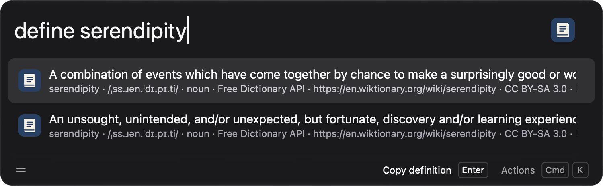

# Wox.Plugin.Dictionary

Look up English definitions directly in [Wox](https://www.woxlauncher.com/). Type `define serendipity` to see definitions, parts of speech, and available pronunciation and examples.



## Requirements

- Wox 2.0.4 or newer and Node.js 22 or newer.
- Development: Python 3, Node.js, npm, [just](https://github.com/casey/just), and [pre-commit](https://pre-commit.com/).

## Install

**Wox store:** Once the plugin is listed, open Wox, type `wpm install`, search for Dictionary, and select it. The listing is not yet submitted.

**Release package:** Download `wox.plugin.Dictionary.wox` from this repository's GitHub Releases and open it with Wox. On Windows and Linux, start Wox once first to register the `.wox` file association.

**Development:** Git clone this repo and run `just install`.

## Usage and sources

Enter `define <word or phrase>`, for example `define serendipity`. Definitions appear inline, with source and available details underneath. Choose a result to copy it. Select a source in **Settings → Plugins → Dictionary** by entering its exact name under **Preferred source**.

| Source              | In-Wox definitions                                                   |
| ------------------- | -------------------------------------------------------------------- |
| Free Dictionary API | Default; includes available pronunciation, examples, and attribution |
| Custom API          | An HTTPS endpoint returning the Free Dictionary API JSON format      |

Lookups are sent to the selected API while you type, after a short delay. When a word is not found, it is also sent to Wikipedia for spelling suggestions; choose one to look it up. Do not search for sensitive text. Free Dictionary API is a community service. Wikipedia suggestions are search corrections and may not always match the intended word.

Merriam-Webster, Dictionary.com, Cambridge, and Oxford Learner's Dictionaries are not currently supported for in-Wox results. Their APIs require separate access or licensing, and the plugin does not scrape their websites. Previous installs that selected one of those sources must change the preferred source in settings.

### Custom dictionary APIs

In plugin settings, add a row under **Custom sources** with a unique name and an HTTPS API URL containing exactly one `{query}` placeholder, for example `https://example.com/api/entries/{query}`. The API must return a JSON array matching the [Free Dictionary API response format](https://dictionaryapi.dev/), including `word`, `meanings`, `partOfSpeech`, and `definitions[].definition`. A normal dictionary webpage URL will not work. Set **Preferred source** to the exact custom name.

The query is URL-encoded; URLs cannot contain credentials, use a non-HTTPS scheme, or place the placeholder in the hostname. Custom settings may sync across Wox devices. Do not put credentials in a custom URL. Existing website-only custom source URLs need to be replaced with compatible API endpoints.

## Development

```sh
just            # prepare: npm ci and install Git hooks
just prepare    # same as above
just install    # build the plugin and open the Wox installer
just test       # deterministic unit tests
just lint       # ESLint
just fmt        # format files
just check fmt  # check formatting
just package    # create dist/wox.plugin.Dictionary.wox
just check      # formatting, lint, tests, and package
```

The pre-commit hook formats and lints staged files. The pre-push hook runs `just check` on the working tree; run `just prepare` after cloning to install both hooks.

[Renovate](https://docs.renovatebot.com/) opens pull requests for npm packages, the npm lockfile, and GitHub Actions using [.github/renovate.json](.github/renovate.json). It requires the [Renovate GitHub App](https://github.com/apps/renovate) on the repository. Node.js stays at the minimum supported version in CI and `engines`; raise it manually.

## Credits & License

Dictionary data is supplied by the selected service. Free Dictionary API returns source and license information with its entries.

This project is licensed under the MIT License. See the [LICENSE](LICENSE) file for details.
